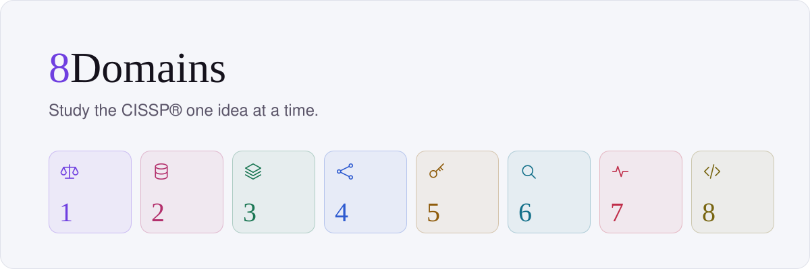

<picture>
  <source media="(prefers-color-scheme: dark)" srcset=".github/readme/banner-dark.svg">
  
</picture>

<br>

A scrollable study feed for the CISSP® exam: short stories, spaced-repetition flashcards and scenario questions across the eight domains. Works offline. No ads, no tracking.

**[8domains.valerio.fyi](https://8domains.valerio.fyi)**

## Stack

React 19 · Vite · Tailwind 4 · [FSRS](https://github.com/open-spaced-repetition/ts-fsrs) · IndexedDB · Cloudflare Workers · Clerk

Progress never leaves the browser. The Worker serves the landing and gates `/app/` behind a session.

## Run

```sh
make dev       # app on localhost, no sign-in
make build     # landing + app in dist/
make preview   # Worker against dist/, keys in worker/.dev.vars
```

Needs [bun](https://bun.sh) and [uv](https://docs.astral.sh/uv/). Out of the box the app runs on [`example-content/`](example-content): lorem ipsum in the real format.

## Content

The study content is not published here. It is still under editorial review: every concept is cross-checked against several study guides and revised as the review goes on, so it is released only inside the app, where there is one reviewed, current version instead of copies going stale.

## Layout

```
app/              React PWA
landing/          static landing, privacy page, security.txt
worker/           Cloudflare Worker: assets, session gate, security headers
pipeline/         compiles content into the app's JSON
example-content/  placeholder content in the real format
```

## License

Code: [MIT](LICENSE). Study content: proprietary, not in this repo. Security reports: [SECURITY.md](SECURITY.md).

<sub>CISSP® is a registered certification mark of ISC2, Inc. 8Domains is not affiliated with, endorsed by or sponsored by ISC2. The outline follows the numbering and weights of the ISC2 CISSP Exam Outline (April 2024), in this project's own words.</sub>
